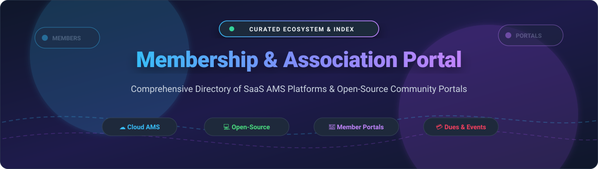

  

# 🏛️ Awesome Membership & Association Portal 🚀

  
  
  
  
  
  
  

> 🌟 **A curated directory of top Membership and Association Portal platforms — both commercial SaaS solutions and self-hosted open-source software for managing member databases, recurring dues, events, directories, and self-service member portals.** 🌟  
> ✨ *Star this repo if you find it useful!* ✨

---

## 📌 Sector Overview & Market Dynamics 📈

The global **Membership Management Software & Association Management System (AMS)** market is estimated at **$5.6B to $6.3B**, projected to surpass **$8.4B+ by 2030** expanding at a CAGR of 4.5% to 11.8% across broader non-profit and community tech segments.

The sector is **moderately to highly fragmented**, characterized by a healthy distribution of specialized vertical players (serving trade associations, makerspaces, sports clubs, chambers of commerce, and alumni networks) alongside mid-market roll-up platforms and private equity aggregators (e.g., Personify, Momentive Software, Togetherwork). The low barrier to entry for cloud solutions and distinct compliance/workflow needs keep the market from becoming a winner-take-all monopoly, sustaining high demand for both specialized SaaS suites and extensible self-hosted open-source frameworks.

---

## 📋 Table of Contents 📑

- [📌 Sector Overview & Market Dynamics](#-sector-overview--market-dynamics-)
- [🟦 SaaS / Hosted Platforms](#-saas--hosted-platforms-)
- [🟩 Open-Source Software](#-open-source-software-)
- [📊 Feature Comparison at a Glance](#-feature-comparison-at-a-glance-)
- [🤝 Contributing](#-contributing-)
- [💖 Support & Sponsorship](#-support--sponsorship-)
- [##  Star Hisoory](#--star-hisoory)
- [📄 License](#-license-)

---

## 🟦 SaaS / Hosted Platforms ☁️

Commercial, cloud-hosted Membership and Association Portal platforms. Platforms are ranked and sorted in descending order by estimated company scale (valuation / annual recurring revenue).

| 🏢 Platform | 📝 Description & Key Strengths | 💼 Company Scale (Revenue / Valuation) | 💵 Starting Price | 🎁 Free Tier / Trial Limit |
| :--- | :--- | :--- | :--- | :--- |
| **[Hivebrite](https://hivebrite.com/)** | 🌐 Branded community portal with member directories, networking hubs, event ticketing, and content sharing tailored for professional associations and alumni networks. | ~$100M–$250M Valuation ($54M+ funding raised; ~$22M estimated ARR) | $895 / month (billed annually, ~$10,740 / year) | ❌ No free tier; No self-service trial (Live demo session upon request) |
| **[WildApricot](https://www.wildapricot.com/)** | 🛠️ All-in-one membership management platform by Personify featuring integrated website builder, dues processing, recurring renewal automations, and member directory. | ~$58.6M ARR (Parent: Personify, Inc. / Rubicon Technology Partners) | $66 / month (billed monthly; $59.40 / month billed annually) for up to 100 contacts | ⏱️ 60-day free trial (Full-feature access, up to 50 contacts, no credit card required) |
| **[MemberClicks](https://www.memberclicks.com/)** | 👥 Turnkey membership database and AMS suite with MC Professional and MC Trade editions, purpose-built for small-to-midsize associations and chambers. | ~$58.6M ARR (Parent: Personify, Inc. / Rubicon Technology Partners) | $3,500 / year (~$291.67 / month) | ❌ No free tier; No self-service trial (Custom guided product tour available) |
| **[GrowthZone](https://www.growthzone.com/)** | 📈 Comprehensive association management software (AMS) featuring member portals, event registration, automated billing, and built-in member communication tools. | ~$20M+ estimated ARR (Backed by Lead Edge Capital; acquired MemberSuite & JUNO) | $3,900 / year (~$325 / month) | ❌ No free tier; No self-service trial (Personalized software demo available) |
| **[Glue Up](https://glueup.com/)** | 🤝 Community and association management platform combining CRM, member engagement apps, multi-chapter administration, and event registration. | ~$14.1M estimated ARR ($10M funding raised; GSR Ventures) | $3,000 / year (~$250 / month billed annually) | ❌ No free tier; No self-service trial (Scheduled live demo available) |

---

## 🟩 Open-Source Software 💻

Self-hosted, community-driven Membership and Association Portal tools. Repositories are ranked and sorted in descending order by GitHub Stars_Count.

### ⛪ [ChurchCRM](https://github.com/ChurchCRM/CRM) 
- ⚙️ **Stack:** PHP / MySQL | 📜 **License:** MIT
- 🔑 **Key Features:** Constituent directory management, family/household profiling, automated subscription tracking, pledge/contribution accounting, event scheduling, and volunteer management.
- 🎯 **Best for:** Faith-based associations, community congregations, and non-profits needing member profiles, volunteer tracking, and pledge management.

### 🏛️ [CiviCRM](https://github.com/civicrm/civicrm-core) 
- ⚙️ **Stack:** PHP / MySQL (Native integrations with WordPress, Drupal, Joomla, Backdrop) | 📜 **License:** AGPL-3.0
- 🔑 **Key Features:** Most established open-source CRM/AMS in the non-profit sector. Includes **CiviMember** for lifecycle tracking, **CiviContribute** for dues and donation processing (Stripe/PayPal), **CiviEvent** for conferences and registrations, dynamic membership seals, and CiviRules automation engine.
- 🎯 **Best for:** Nonprofits, advocacy groups, and large associations requiring deep CRM capabilities, multi-channel communications, and complete database control.

### 🌟 [Tendenci](https://github.com/tendenci/tendenci) 
- ⚙️ **Stack:** Python / Django / PostgreSQL | 📜 **License:** GPL-3.0+
- 🔑 **Key Features:** Full-featured Association Management System (AMS) and Content Management System (CMS) in a single platform. Features membership tiers, self-service member dashboards, recurring billing, event registration, corporate memberships, job boards, and community forums.
- 🎯 **Best for:** Professional associations, societies, and foundations seeking an all-in-one web portal with integrated CMS and robust membership administration.

### 🛡️ [Admidio](https://github.com/admidio/admidio) 
- ⚙️ **Stack:** PHP / MySQL / PostgreSQL | 📜 **License:** GPL-2.0
- 🔑 **Key Features:** Modular membership administration system featuring hierarchical role-based permissions, customizable profile fields, progressive web app (PWA) installation, document libraries, event calendars, messaging, and announcement channels.
- 🎯 **Best for:** Clubs, sports teams, alumni groups, and community societies requiring flexible role assignments and mobile-friendly PWA access.

### 🔗 [Hitobito](https://github.com/hitobito/hitobito) 
- ⚙️ **Stack:** Ruby on Rails / PostgreSQL | 📜 **License:** AGPL-3.0
- 🔑 **Key Features:** Scalable community and membership management platform engineered for complex hierarchical group structures, nested chapters, course and event administration, and localized member communications via modular "Wagons" plugins.
- 🎯 **Best for:** Large multi-chapter organizations, youth associations, and federations with nested regional administrative hierarchies.

### 📦 [byro](https://github.com/byro/byro) 
- ⚙️ **Stack:** Python / Django | 📜 **License:** AGPL-3.0
- 🔑 **Key Features:** Unopinionated, plugin-extensible membership management engine designed for small and medium-sized clubs and associations. Features CAMT.053 bank transaction imports, automated membership receipt generation, Mailman mailing list synchronization, and Docker deployment via `byroctl`.
- 🎯 **Best for:** European and DACH-region associations and clubs wanting clean, extensible Django architecture with bank sync capabilities.

### 🛠️ [MemberMatters](https://github.com/membermatters/MemberMatters) 
- ⚙️ **Stack:** Python / Django / Vue.js | 📜 **License:** MIT
- 🔑 **Key Features:** Membership management platform designed specifically for makerspaces, hackerspaces, and co-working groups. Combines Stripe subscription billing with physical IoT access control (RFID door and equipment interlocks), on-site kiosk mode, automated member inductions, and Discourse SSO.
- 🎯 **Best for:** Makerspaces, workshop co-ops, and shared creative facilities requiring integrated billing and physical hardware access permissions.

### 📑 [Galette](https://github.com/galette/galette) 
- ⚙️ **Stack:** PHP / MySQL / PostgreSQL | 📜 **License:** GPL-3.0
- 🔑 **Key Features:** Lightweight web-based member database for non-profit organizations. Supports membership card generation, contribution tracking, dues history, email notifications, CSV imports/exports, and customizable member fields.
- 🎯 **Best for:** Small to mid-sized non-profits and volunteer associations seeking a straightforward, reliable PHP-based membership and dues tracking system.

### 🏷️ [South London Makerspace Membership System](https://github.com/southlondonmakerspace/membership-system) 
- ⚙️ **Stack:** Python / Flask | 📜 **License:** Open Source
- 🔑 **Key Features:** Dedicated membership database system managing member profiles, automated recurring subscription payments, RFID access control card permissions, event logs, and Discourse forum role sync.
- 🎯 **Best for:** Hacker-spaces and community workshops looking for a lean member records database connected to physical card access.

### 🔧 [OpenRepairPlatform](https://github.com/AtelierSoude/OpenRepairPlatform) 
- ⚙️ **Stack:** Python / Django | 📜 **License:** AGPL-3.0
- 🔑 **Key Features:** Web application designed for non-profit collaborative associations and community repair cafes. Features member registration, workshop event scheduling, volunteer coordination, and inventory management.
- 🎯 **Best for:** Community repair workshops, eco-initiatives, and mutual-aid societies.

### 🎼 [Cantiga](https://github.com/zyxist/cantiga) 
- ⚙️ **Stack:** PHP / Symfony | 📜 **License:** BSD-3-Clause
- 🔑 **Key Features:** Membership management framework created to support non-profit organizations administering complex initiatives, member rosters, and regional sub-chapters.
- 🎯 **Best for:** Non-profit project consortiums and regional association branches.

### 🤝 [Socius](https://github.com/rufusinfabula/Socius) 
- ⚙️ **Stack:** PHP / MySQL | 📜 **License:** GPL-3.0
- 🔑 **Key Features:** Simple, self-hosted association management application with WordPress-like installation simplicity. Features member registry with permanent numbers, annual renewals, PayPal and Satispay payment reconciliation, event landing pages, and meeting minute exports.
- 🎯 **Best for:** Small European cultural and social associations seeking easy LAMP-stack deployment.

---

## 📊 Feature Comparison at a Glance 🔍

| 💻 Software | 📜 License | ⚙️ Primary Stack | 💳 Dues / Payments | 🎟️ Events & Ticketing | 🏠 Self-Hosted | 🎯 Primary Target Audience |
| :--- | :--- | :--- | :--- | :--- | :--- | :--- |
| **Hivebrite** | Proprietary | Cloud SaaS | ✅ Integrated | ✅ Advanced | ❌ | Alumni networks & large associations |
| **WildApricot** | Proprietary | Cloud SaaS | ✅ Automatic & manual | ✅ Built-in | ❌ | Small-to-midsize associations & clubs |
| **MemberClicks** | Proprietary | Cloud SaaS | ✅ Automated | ✅ Built-in | ❌ | Professional associations & chambers |
| **GrowthZone** | Proprietary | Cloud SaaS | ✅ Full billing engine | ✅ Advanced | ❌ | Mid-market trade associations & chambers |
| **Glue Up** | Proprietary | Cloud SaaS | ✅ Multi-currency | ✅ Built-in | ❌ | Global associations & multi-chapter orgs |
| **ChurchCRM** | MIT | PHP / MySQL | ✅ Pledges & giving | ✅ Built-in | ✅ | Faith-based groups & community orgs |
| **CiviCRM** | AGPL-3.0 | PHP / MySQL / CMS | ✅ Stripe / PayPal | ✅ Full suite | ✅ | Nonprofits, advocacy & large NGOs |
| **Tendenci** | GPL-3.0+ | Python / Django | ✅ Built-in payments | ✅ Full suite | ✅ | Associations & societies needing CMS+AMS |
| **Admidio** | GPL-2.0 | PHP / MySQL | (Check plugins) | ✅ Built-in | ✅ | Sports clubs, hobby groups & societies |
| **Hitobito** | AGPL-3.0 | Ruby on Rails | ✅ Via plugins | ✅ Courses & events | ✅ | Multi-tiered youth groups & federations |
| **byro** | AGPL-3.0 | Python / Django | ✅ SEPA & CAMT.053 | (Check plugins) | ✅ | DACH clubs & non-profit associations |
| **MemberMatters** | MIT | Python / Django | ✅ Stripe recurring | (Induction focus) | ✅ | Makerspaces & tool-access workshops |
| **Galette** | GPL-3.0 | PHP / MySQL | ✅ Dues tracking | (Check plugins) | ✅ | Nonprofits seeking simple dues ledger |
| **Socius** | GPL-3.0 | PHP / MySQL | ✅ PayPal & Satispay | ✅ Built-in | ✅ | Small European cultural clubs |

---

## 🤝 Contributing 🚀

Contributions are welcome! If you know of an open-source Membership or Association Portal tool that should be listed here, please open a pull request with:

1. 🏷️ Project name and active repository URL.
2. 📝 Brief description (1–2 sentences highlighting unique features).
3. ⚙️ Stack and license.
4. 💡 Why it stands out for associations, non-profits, or community organizations.

Please ensure the project is actively maintained (releases or commits within the last 12 months) and genuinely open-source.

---

## 💖 Support & Sponsorship ✨

Thank you for exploring **Awesome Membership & Association Portal**! 🌟

If this project helps you discover software solutions for your association, nonprofit, or club:
- ⭐ **Star** this repository to help others discover it.
- 🔀 **Fork** it to keep your own tailored shortlist.
- 📢 **Share** it with your community leaders and developers.

### ☕ Sponsor & Buy a Coffee
If you would like to support ongoing updates and maintenance of this list, consider buying a coffee or sponsoring the project:

---

##  Star Hisoory

---

## 📄 License ⚖️

This compilation is released under [CC0 1.0 Universal (Public Domain)](LICENSE). Individual software projects listed retain their respective licenses.
